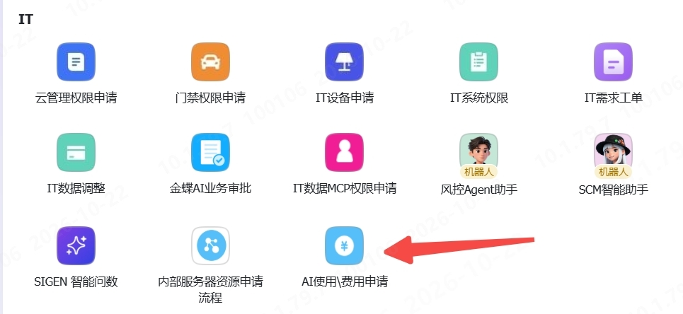
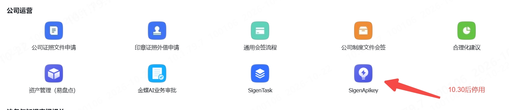
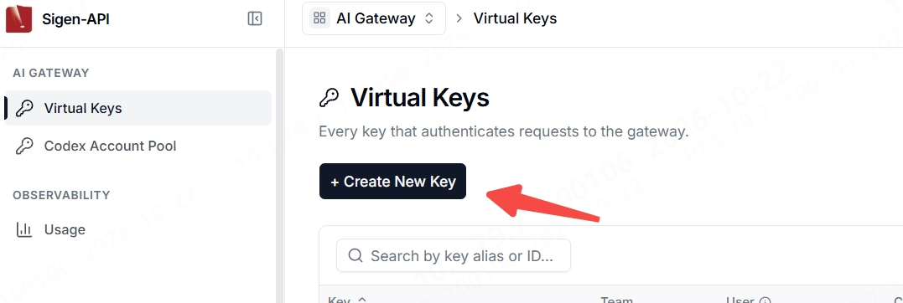
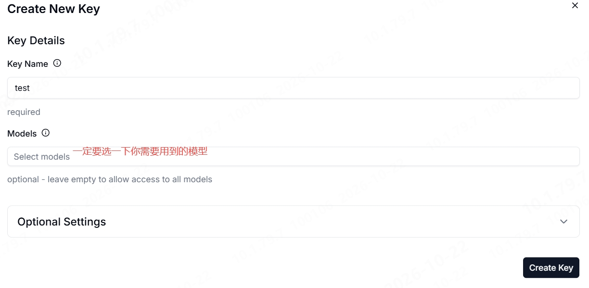
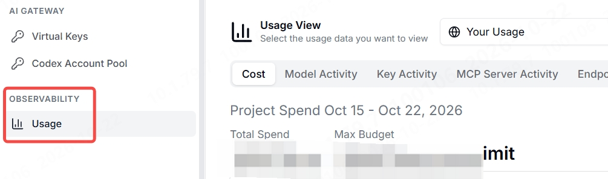

@所有人 各位同事大家好，鉴于公司 AI 使用费用增速较快，公司对 **codex 订阅**与**中转模型用量做适当管控**。倡导大家合理使用 AI 资源，**减少不必要 token 消耗**。

方案如下：

A，对于 codex 账号订阅：

A.1，对于软件开发部门（软件部、云计算中心、信息技术部）默认可订阅。部门成员订阅计划（100\200\500）由部门主管把控

A.2，对于非软件开发部门，采用事前申请原则，申请入口：

B，对于中转模型使用：

B.1，原中转站 [https://qwertyui0p.sigenergy.com/v1](https://qwertyui0p.sigenergy.com/v1) 在 **10 月 30 日停用**。**今天！就是今天！**

B.2，使用新版中转站 [https://sigen-api.sigenergy.com/ui](https://sigen-api.sigenergy.com/ui) ，此中转站只**开放内网使用，不会再开放任何外网使用**。

**需要各位同事切换一下 base_url 与对应的 key**

B.3，对于软件开发部门，可使用 glm 与 k 3 模型；非软件开发部门，可见 deepseek 系列模型

B.4，对于 codex 的中转，在以上流程中申请使用。但是 codex 账号池不能规模性使用，会被 openAI 限流报错 429。

B.5，所有中转模型**每人每月限额 100 美金，超额可在以上流程中申请**。可申请永久与当月

B.6，实际用量查看路径：

原因是 CCSwitch 里 Codex 上游地址的路径配置错了：原来指向 https://sigen-api.sigenergy.com/ui，这是网页入口，不是 API 接口。Codex 用 POST /responses 请求模型时，Nginx 在 /ui 路径返回 405 Method Not Allowed。改为 API 地址 https://sigen-api.sigenergy.com/v1 后，请求就到达了正确的 API 服务，所以恢复正常。wire_api 应保持 responses；